# Конспект: Управление памятью

---

## 1. Введение

Всем компьютерам требуется место для временного хранения информации во время обработки. В цифровых компьютерах хранение информации выполняется на двух уровнях:

- **Первичная память** — построена на полупроводниковых чипах ОЗУ (RAM) и ПЗУ (ROM).
- **Память для хранения больших объёмов** — обычно жёсткие диски, SSD и другие накопители.

Память — один из важнейших компонентов компьютерной системы. Она связана со всеми устройствами, отвечающими за хранение данных и приложений на временной или постоянной основе.

---

## 2. План лекции

1. Иерархическая организация памяти в ЭВМ  
2. Функции ОС по управлению памятью  
3. Организация памяти  
4. Стратегии управления памятью  
5. Виды организации реальной памяти  
6. Концепция виртуальной памяти  

---

## 3. Структура ЭВМ. Принцип фон Неймана

Память является ключевым компонентом архитектуры фон Неймана. Без оперативной памяти невозможно хранить промежуточные результаты вычислений и процессы.

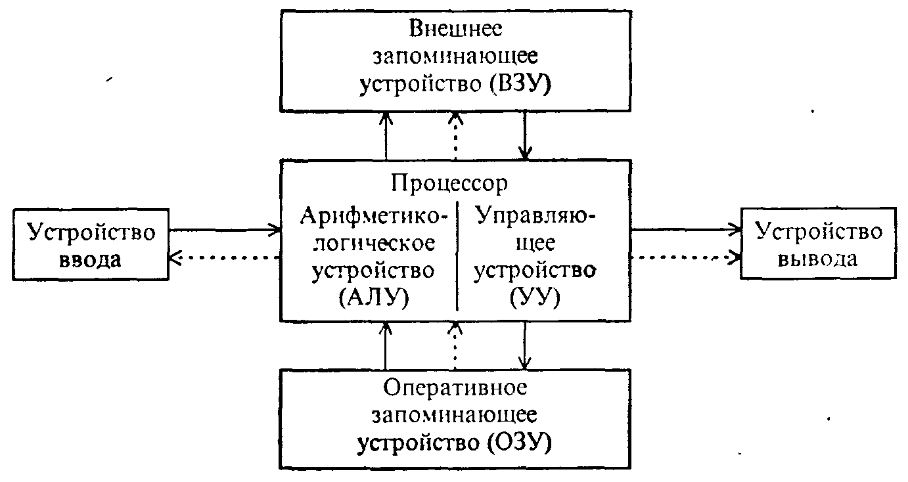

### Основные характеристики памяти ЭВМ

- Состоит из двоичных запоминающих элементов — **битов**.
- В современных ЭВМ используются ячейки из 4 байт (**слова**).
- В каждую ячейку записывается одно слово или одна команда.
- Принята 32-разрядная (и 64-разрядная) адресация: число независимых адресов = \(2^{32}\) (или \(2^{64}\)).

### Разбиение памяти на слова

| Разрядность процессора | Единицы |
|------------------------|---------|
| 64-разрядный           | Двойное слово |
| 32-разрядный           | Слово |
| 16-разрядный           | Полуслово |
| 8-разрядный            | Байт |

---

## 4. Классификация памяти

### 4.1. По реализации

| Тип | Примеры |
|-----|---------|
| **Электронные схемы** | ПЗУ (ROM), ОЗУ (RAM) |
| **Накопители** | Магнитные диски (HDD, FDD), магнитные ленты, оптические диски (CD, DVD), флэш-память |

### 4.2. По энергозависимости

| Тип | Описание |
|-----|----------|
| **Энергонезависимая** (ПЗУ, ROM) | Информация сохраняется при отключении питания. Содержит BIOS, программы начального запуска. |
| **Энергозависимая** (ОЗУ, RAM) | Информация теряется при отключении питания. Используется для хранения текущих программ и данных. |

### 4.3. Основные виды памяти

- **RAM (Random Access Memory)** — оперативная память с произвольным доступом.
  - **SRAM** (Static RAM) — на триггерах, быстрая, дорогая, используется в кэше.
  - **DRAM** (Dynamic RAM) — на конденсаторах, требует регенерации, дешевле.
- **ROM (Read Only Memory)** — постоянная память (BIOS).
- **CMOS** — малопотребляющая память для хранения настроек BIOS и часов реального времени (питается от батареи).
- **Флэш-память** — энергонезависимая, используется в USB-накопителях, SSD.
- **Видеопамять (VRAM)** — специальный вид ОЗУ для хранения изображений.

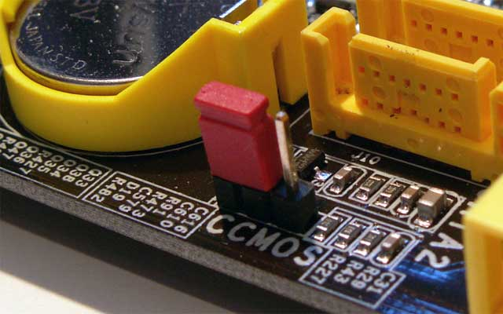

### 4.4. BIOS

- **Basic Input/Output System** — базовая система ввода-вывода.
- Хранится в ПЗУ на материнской плате.
- Содержит:
  - программу POST (самотестирование при включении);
  - драйверы базовых устройств;
  - программу загрузки ОС.
- При включении ПК BIOS копируется из ROM в RAM для ускорения доступа.

---

## 5. Иерархическая организация памяти

Современные ЭВМ имеют **многоуровневую** иерархию запоминающих устройств, отличающихся временем доступа и стоимостью хранения бита.

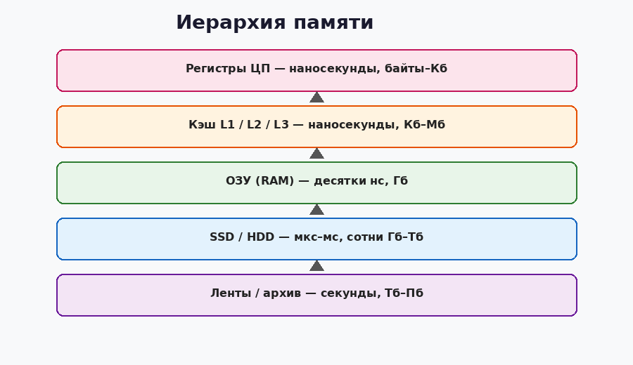

Чем ближе к процессору — тем выше скорость и стоимость, тем меньше объём.

### 5.1. Кэш-память

**Кэш** — промежуточный буфер с быстрым доступом, содержащий наиболее вероятные к запросу данные.

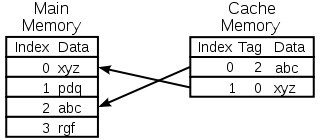

#### Принцип работы

- **Кэш-попадание (cache hit)** — данные найдены в кэше → быстрый доступ.
- **Кэш-промах (cache miss)** — данных нет → загрузка из основной памяти, затем использование.
- **Коэффициент попаданий** — процент успешных обращений к кэшу.

#### Типы записи

- **С обратной записью (write-back)** — изменения сначала в кэш, потом в ОЗУ.
- **Со сквозной записью (write-through)** — изменения одновременно в кэш и ОЗУ.

#### Уровни кэш-памяти

| Уровень | Расположение | Характеристики |
|---------|--------------|----------------|
| **L1** | Внутри процессора | Самый быстрый, небольшой объём |
| **L2** | На кристалле процессора | Больше L1, чуть медленнее |
| **L3** | Общий для ядер | Ещё больше, медленнее L2, но быстрее RAM |
| **L4** | Отдельная микросхема | Для мощных серверов и мейнфреймов |

---

## 6. Функции ОС по управлению памятью

1. Отслеживание свободной и занятой памяти.
2. Выделение памяти процессам и освобождение при завершении.
3. Вытеснение процессов (или их частей) на диск при нехватке ОЗУ и возврат обратно.
4. Настройка (преобразование) адресов программы на конкретную область физической памяти.
5. **Защита памяти** — предотвращение доступа одного процесса к памяти другого.

---

## 7. Организация оперативной памяти

- Физически — линейная последовательность адресуемых ячеек (байтов).
- Размер измеряется в Кб, Мб, Гб, Тб (\(1\) Кб \(= 1024\) байт).
- Делится на:
  - **Слово** — единица обмена с ЦП (зависит от разрядности).
  - **Блок** — непрерывная область с общим ключом защиты (часто 2 Кб).
  - **Сегмент** — логический участок памяти (может содержать несколько блоков).

---

## 8. Стратегии управления памятью

ОС постоянно решает: **когда**, **куда** и **за счёт кого** загружать процесс/данные в ОЗУ.

### Три основные стратегии

| Стратегия | Вопрос | Варианты |
|-----------|--------|----------|
| **Выборки (вталкивания)** | Когда загружать? | По запросу / с упреждением |
| **Размещения** | Куда помещать? | Первый подходящий / наиболее подходящий / наименее подходящий |
| **Замещения (выталкивания)** | Что выгружать? | FIFO, LRU, LFU, NUR, случайный |

#### Стратегия выборки

- **По запросу** — загружаем только когда процесс обратился к странице/сегменту.
- **С упреждением** — пытаемся предсказать, какие страницы понадобятся (на основе локальности).

#### Стратегия размещения

- **Первый подходящий** — быстрее по времени.
- **Наиболее подходящий** — минимизирует потери памяти.
- **Наименее подходящий** — оставляет большие свободные куски.

#### Стратегии выталкивания

- **FIFO** — первая пришедшая.
- **LRU** (Least Recently Used) — дольше всего не использовавшаяся.
- **LFU** (Least Frequently Used) — реже всего используемая.
- **NUR** (Not Used Recently) — не использовавшаяся в последнее время.
- Случайная страница.

---

## 9. Виды организации реальной памяти

### 9.1. Однопрограммная организация

- Вся память (кроме ОС) отдаётся одному процессу.
- **Достоинства**: простота защиты (пара регистров границ).
- **Недостатки**: простой ЦП и устройств ввода-вывода, низкая эффективность.

### 9.2. Мультипрограммная с фиксированными разделами

- Память статически делится на разделы фиксированного размера.

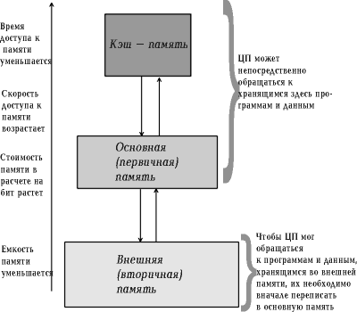

- **Достоинства**: выше загрузка ЦП.
- **Недостатки**:
  - Внешняя фрагментация (большие программы не влезают).
  - Внутренняя фрагментация (неиспользованное место внутри раздела).

### 9.3. Мультипрограммная с динамическими (переменными) разделами

- Память выделяется по запросу ровно столько, сколько нужно.

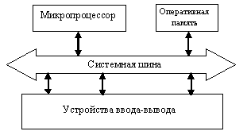

- **Достоинства**: нет внешней фрагментации, выше уровень мультипрограммирования.
- **Недостатки**: внутренняя фрагментация, проблема «дыр» (несмежные свободные участки).

### 9.4. Перемещаемые разделы

- Для борьбы с фрагментацией выполняется **сжатие (уплотнение)** памяти — все занятые участки сдвигаются, свободная память объединяется.
- Требует динамического преобразования адресов.
- **Недостатки**: затраты времени ЦП, приостановка процессов.

---

## 10. Методы распределения памяти с использованием диска

### 10.1. Свопинг (Swapping)

- Образы процессов выгружаются на диск и возвращаются **целиком**.
- Простой, но избыточный: часто не нужно загружать/выгружать весь процесс.
- Не позволяет запускать процессы, превышающие размер ОЗУ.

### 10.2. Виртуальная память

- Между ОЗУ и диском перемещаются **части** образов процессов (страницы или сегменты).
- Пользователю/программе кажется, что доступна почти неограниченная память.

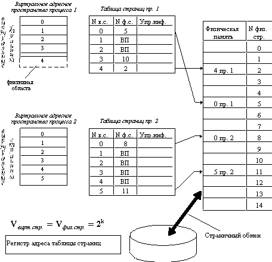

---

## 11. Концепция виртуальной памяти

### 11.1. Определение

**Виртуальная память** — основная память процесса, адресное пространство которого соответствует диапазону адресации системы команд, но обычно не совпадает с объёмом реальной ОЗУ.

Пользователь пишет программу так, будто у него есть большая однородная память. На самом деле данные хранятся на диске и по частям отображаются в реальную память.

### 11.2. Цели

1. Позволить создавать и выполнять программы максимально допустимого размера.
2. Снять с программиста заботу об ограниченном объёме ОЗУ.
3. Устранить временную фрагментацию и эффективно использовать ОЗУ.

### 11.3. Суть

- Адресное пространство процесса **отделено** от реальных адресов ОЗУ.
- Отображение происходит **динамически** и **по частям**.
- Программа ничего не знает об этом — выполняется так, будто полностью находится в ОЗУ.

### 11.4. Исторические предшественники

1. **Оверлеи (Overlays)** — программист вручную разбивает программу на части, которые поочерёдно загружаются в одну область памяти.
2. **Свопинг** — выгрузка/загрузка процессов целиком.
3. **Виртуальная память** — автоматическое управление частями процессов (страницами/сегментами).

---

## 12. Схема работы виртуальной памяти

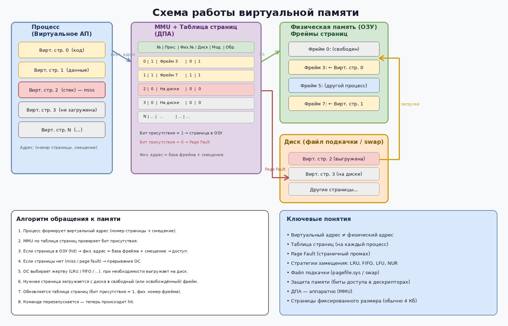

### 12.1. Страничная организация

- Виртуальное адресное пространство делится на **виртуальные страницы** одинакового размера.
- Физическая память делится на **физические страницы (фреймы)** того же размера.
- Размер страницы обычно степень двойки (4 Кб, 8 Кб и т.д.).
- Адрес: `(номер страницы, смещение)`.
- Для каждого процесса — **таблица страниц** (дескрипторы):
  - бит присутствия;
  - физический номер страницы (или адрес на диске);
  - бит модификации;
  - бит обращения;
  - права доступа и т.д.

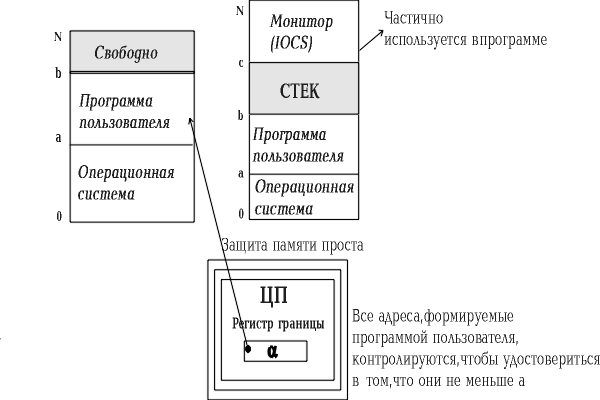

**Алгоритм обращения:**

1. Процесс генерирует виртуальный адрес.
2. По номеру страницы ищется запись в таблице страниц.
3. Если страница в ОЗУ (бит присутствия = 1) → формируется физический адрес.
4. Если нет → **страничный промах (page fault)** → ОС загружает страницу с диска (возможно, вытесняя другую).

### 12.2. Сегментная организация

- Программа делится на **логические сегменты** (код, данные, стек и т.д.) переменного размера.
- Каждый сегмент размещается как самостоятельная единица.
- Адрес: `(номер сегмента, смещение)`.
- Таблица сегментов содержит базовый адрес и длину сегмента.
- **Недостаток**: фрагментация на уровне сегментов, более медленное преобразование адреса.

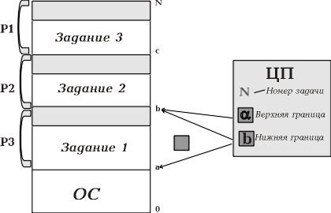

### 12.3. Сегментно-страничная организация

- Виртуальное пространство делится на сегменты.
- Каждый сегмент делится на страницы.
- Адрес: `(номер сегмента, номер страницы, смещение)`.
- Для каждого сегмента — своя таблица страниц.
- Наиболее гибкий, но более сложный и медленный способ.

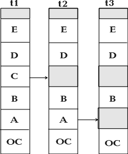

---

## 13. Динамическое преобразование адресов (ДПА)

**ДПА** — механизм, устанавливающий соответствие между виртуальными и физическими адресами.

- Поддерживается аппаратно (MMU — Memory Management Unit).
- Ведётся таблица отображения блоков.
- Отображение выполняется на уровне страниц/сегментов (не побайтно).

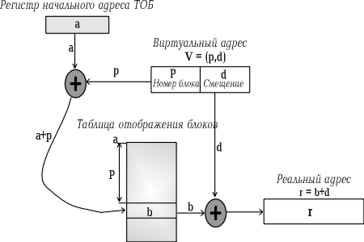

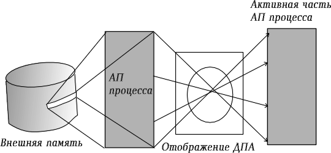

### Вопросы, которые решает ОС

1. Какую часть процессов держать в ОЗУ?
2. Какой размер блока выбрать?  
   - Большой блок → меньше таблиц, но больше лишнего трафика.  
   - Малый блок → больше таблиц, меньше лишнего.

---

## 14. Защита памяти

Важная задача ОС: не позволить процессу читать/писать в память, назначенную другому процессу.

Реализуется программно-аппаратно:
- биты защиты в дескрипторах страниц/сегментов;
- проверка при каждом обращении;
- аппаратное прерывание при нарушении.

---

## 15. Выводы

- Память организована иерархически: регистры → кэш → ОЗУ → диск.
- ОС управляет памятью: выделяет, освобождает, защищает, вытесняет.
- Реальная память может быть организована с фиксированными/динамическими/перемещаемыми разделами.
- **Виртуальная память** — ключевая технология современных ОС, позволяющая:
  - запускать программы, превышающие размер ОЗУ;
  - эффективно использовать физическую память;
  - обеспечивать изоляцию процессов.
- Основной механизм — страничная (или сегментно-страничная) организация с динамическим преобразованием адресов и подкачкой страниц по требованию.

---

*Конспект составлен по материалам презентации «Управление памятью».*
