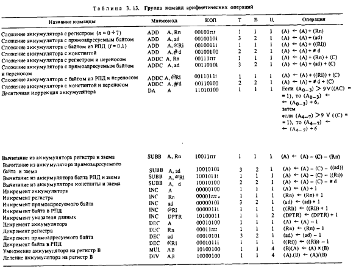
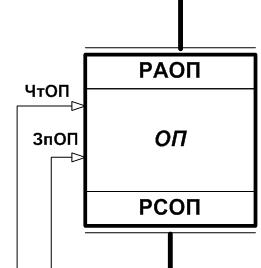
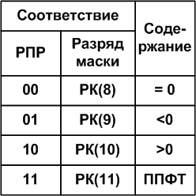
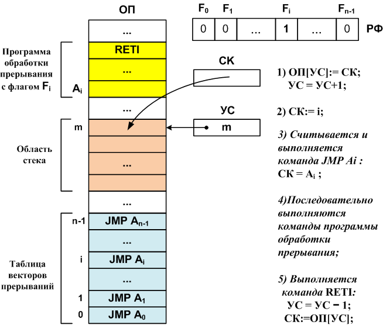

# Конспект: Взаимодействие устройств ЭВМ в процессе выполнения машинной команды (Рабочий цикл процессора)

**Тема:** Рабочий цикл процессора. Элементы процессора. Устройство управления. Прерывания.

---

## 1. Введение. Программа и команды

В каждый момент времени компьютер выполняет **программу** — последовательность действий (команд), направленную на преобразование входных данных в результат.

- Команды и данные текущей программы хранятся в **оперативной памяти (ОП)**.
- Выполняет команды **процессор**.

**Ключевые вопросы:**
- В каком виде хранятся данные и команды?
- Откуда процессор знает, где в ОП находится очередная команда и данные для неё?

---

## 2. Представление данных и команд

### 2.1. Представление данных
- Числа — в двоичной системе счисления (форматы со знаком, с фиксированной и плавающей точкой).
- Символы — двоичными кодами.
- Двоичные векторы (для поразрядных логических операций) — последовательности битов (обычно беззнаковые целые).

**Пример:**
```
1·2⁰ + 0·2¹ + 1·2² + 1·2³ + 0·2⁴ + 1·2⁵ + 1·2⁶ = 1 + 4 + 8 + 32 + 64 = 109
```

### 2.2. Представление команд
**Команда** — приказ компьютеру выполнить операцию (например, сложение двух операндов из ОП).

Типичный формат двухадресной команды:

| КОП | Адрес 1-го операнда (A1) | Адрес 2-го операнда (A2) |
|-----|---------------------------|---------------------------|

- Результат обычно записывается на место первого операнда.
- Каждый процессор имеет свою **систему команд** (арифметические, логические, пересылки, передачи управления, ввода-вывода и др.).

Пример фрагмента системы команд микроконтроллера КМ1816ВЕ51 (МК-51):



---

## 3. Аппаратное обеспечение процессора и ОП

### 3.1. Основные регистры процессора
| Регистр | Назначение |
|---------|------------|
| **РК**  | Регистр команд (хранит выбранную команду на всём протяжении её выполнения) |
| **ПортА** | Порт адреса (подключён к шине адреса) |
| **ПортД** | Порт данных (подключён к шине данных) |
| **Р1**  | Аккумулятор АЛУ |
| **Р2**  | Второй регистр АЛУ |
| **СчАК (СК, PC)** | Счётчик адреса команды (адрес следующей команды) |

### 3.2. Регистры оперативной памяти
- **РАОП** — регистр адреса ОП
- **РСОП** — регистр слова ОП

### 3.3. Другие устройства
- **АЛУ** — арифметико-логическое устройство
- **Шины**: адреса, данных, управления
- **УУиС** — устройство управления и синхронизации
- **Генератор синхросерии** (С)
- **Дешифратор КОП** (DC)

### 3.4. Операции чтения и записи в ОП

**Чтение из ОП:**
1. Выставить адрес на шину адреса (в РАОП)
2. Сформировать сигнал **ЧтОП**
3. Данные появляются в РСОП и поступают в порт данных процессора

**Запись в ОП:**
1. Выставить адрес на шину адреса
2. Выставить данные на шину данных (в РСОП)
3. Сформировать сигнал **ЗпОП**



---

## 4. Рабочий цикл процессора (на примере двухадресной арифметической/логической команды)

Рабочий цикл состоит из **5 основных этапов**.

### Этап 1. Выборка команды из ОП
```
1) y1:  ПортА := СчАК
2) y2:  ЧтОП
3) y3:  РК  := ПортД
```

### Этап 2. Выборка операндов из ОП

**2.1. Первый операнд:**
```
4) y4:  ПортА := A1
5) y2:  ЧтОП
6) y5:  Р1  := ПортД
```

**2.2. Второй операнд:**
```
7) y6:  ПортА := A2
8) y2:  ЧтОП
9) y7:  Р2  := ПортД
```

### Этап 3. Выполнение операции в АЛУ
- Значение поля КОП в РК дешифруется на DC → сигнал `xi = 1`
- УУиС формирует управляющий сигнал `yiАЛУ = 1`
- АЛУ выполняет соответствующую микропрограмму
- Результат помещается в аккумулятор **Р1**

**Уточнение (сигналы занятости и признаков):**
- АЛУ выставляет `ZАЛУ = 1` (занято), пока выполняет операцию
- После завершения `ZАЛУ = 0` (свободно)
- Формируются признаки результата (унитарный код → позиционный):
  - 00 — ноль
  - 01 — меньше нуля
  - 10 — больше нуля
  - 11 — переполнение

- Также флаги исключительных ситуаций (переполнение порядка, исчезновение порядка, потеря значимости, деление на ноль)

### Этап 4. Запись результата в ОП (на место первого операнда)
```
11) y8:  ПортД := Р1
12) y4:  ПортА := A1
13) y9:  ЗпОП
```
(Также может записываться признак результата в регистр ПР)

### Этап 5. Продвижение счётчика команд
```
14) y10: СчАК := СчАК + L
```
где **L** — длина выполненной команды в байтах.

> Этот этап можно выполнять сразу после выборки команды.

---

## 5. Упрощённая структурная схема и УГО процессора

После включения (сигналы Set/Reset) УУиС вырабатывает `y0`, устанавливающий **СчАК** на начальный адрес программы.

УУиС реализует микропрограмму, состоящую из бесконечного повторения этапов рабочего цикла + обработки прерываний (если они возникли).

**Обобщённое условно-графическое обозначение (УГО) процессора:**
- Выводы порта адреса
- Выводы порта данных
- Сигналы Чтение/Запись для ОП
- Сигналы Чтение/Запись для периферии
- Возможность подключения внешнего генератора

---

## 6. Пример выполнения команды сложения (с фиксированной точкой)

**Исходные данные примера:**
- Система команд: 256 команд → поле КОП = 8 бит
- Два операнда в ОП (прямая адресация)
- Ширина шины данных = 32 бита
- Ширина шины адреса = 8 бит → объём ОП ≤ 256 байт
- Принстонская (фон-неймановская) архитектура: команды и данные в одной памяти
- СчАК = СК = PC (Program Counter)

**Последовательность действий:**
1. Процессор выставляет на шину адреса значение СК
2. Из ОП считывается команда → попадает в РК
3. Из РК выставляется адрес первого операнда
4. Считывается 1-й операнд → в аккумулятор (Р1)
5. Выставляется адрес второго операнда
6. Считывается 2-й операнд → в Р2
7. АЛУ выполняет операцию (сложение) → результат в Р1
8. Адрес первого операнда снова выставляется
9. Результат записывается в ОП на место 1-го операнда
10. СК увеличивается на длину команды (в примере — 3 байта)
11. Цикл повторяется для следующей команды

---

## 7. Элементы процессора (из теории)

### 7.1. Основные составляющие
- Дешифратор команд
- Операционные устройства (АЛУ)
- Устройство управления
- Регистры
- Транслятор адресов операндов
- Шины

### 7.2. Операционные устройства
Строятся на базе:
- **Регистров** (хранение слов)
- **Шин** (передача данных)
- **Комбинационных схем** (вычисления по управляющим сигналам)

**АЛУ** — комбинационная схема (без внутренней памяти), принимающая два операнда и формирующая результат.

Типичные операции:
- целочисленная арифметика
- логические операции
- сдвиги
- десятичная арифметика
- операции с плавающей запятой
- графические и др.

### 7.3. Устройство управления
Реализует автоматическое выполнение команд программы:
- выборка команды из ОЗУ
- дешифрация КОП
- формирование адресов операндов
- выборка операндов
- передача в операционное устройство
- запись результата
- модификация счётчика команд

Часто реализуется как **микропрограммный автомат**.

---

## 8. Обработка прерываний (векторная система)



1. Содержимое СК (адрес возврата) сохраняется в стеке:
   ```
   ОП[УС] = СК
   УС = УС + 1
   ```
2. В СК загружается адрес слова из таблицы векторов прерываний (ТВП), соответствующий причине прерывания:
   ```
   СК = i
   ```
3. Выполняется команда безусловного перехода `JMP Ai` → СК = Ai
4. Выполняется программа обработки прерывания
5. Команда **RETI** (Return from Interrupt):
   ```
   УС = УС – 1
   СК = ОП[УС]
   ```
   Работа продолжается с прерванного места.

**Недостаток векторных систем:** сохраняется только адрес возврата. Сохранение регистров (РОН, РСФ, РПР и др.) возлагается на программиста.

Более совершенные системы сохраняют/восстанавливают также **слово состояния программы (ССП / PSW)**.

---

## 9. Краткая схема рабочего цикла (для запоминания)

```
┌─────────────────────────────────────┐
│  1. Выборка команды (Fetch)         │
│     СчАК → Адрес → ЧтОП → РК        │
├─────────────────────────────────────┤
│  2. Выборка операндов (Operand)     │
│     A1/A2 → Адрес → ЧтОП → Р1/Р2    │
├─────────────────────────────────────┤
│  3. Выполнение в АЛУ (Execute)      │
│     КОП → DC → yiАЛУ → результат Р1 │
├─────────────────────────────────────┤
│  4. Запись результата (Write-back)  │
│     Р1 → Данные → A1 → ЗпОП         │
├─────────────────────────────────────┤
│  5. Продвижение СчАК                │
│     СчАК := СчАК + L                │
└─────────────────────────────────────┘
         ↓ (повтор / прерывание)
```

---

## Полезные обозначения

| Сокращение | Расшифровка |
|------------|-------------|
| ОП / ОЗУ   | Оперативная память |
| АЛУ        | Арифметико-логическое устройство |
| УУиС       | Устройство управления и синхронизации |
| РК         | Регистр команд |
| СчАК / СК / PC | Счётчик команд |
| КОП        | Код операции |
| DC         | Дешифратор |
| ЧтОП / ЗпОП | Чтение / Запись оперативной памяти |
| ТВП        | Таблица векторов прерываний |
| RETI       | Возврат из прерывания |
| PSW / ССП  | Слово состояния программы |

